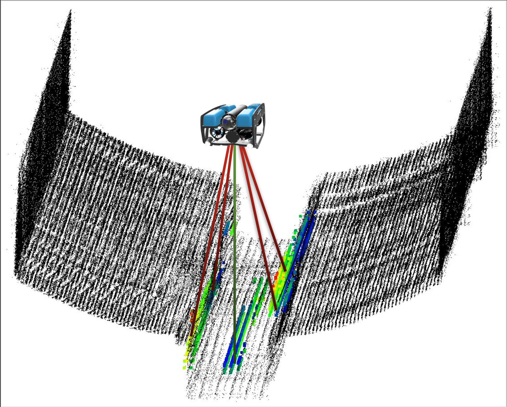

**Authors:** Jingyu Song\*, Onur Bagoren\*, Katherine A. Skinner  
(\* equal contribution)

**Venue:** OCEANS 2023 Limerick

Underwater robots must navigate without GPS, relying on acoustic sensors. We introduce an uncertainty-aware probabilistic framework for acoustic localization and mapping that explicitly reasons about measurement noise and model uncertainty, improving robustness in real-world deployments.

[Paper](https://ieeexplore.ieee.org/document/10244679) | [Project Page](https://umfieldrobotics.github.io/PUMA.github.io/)

