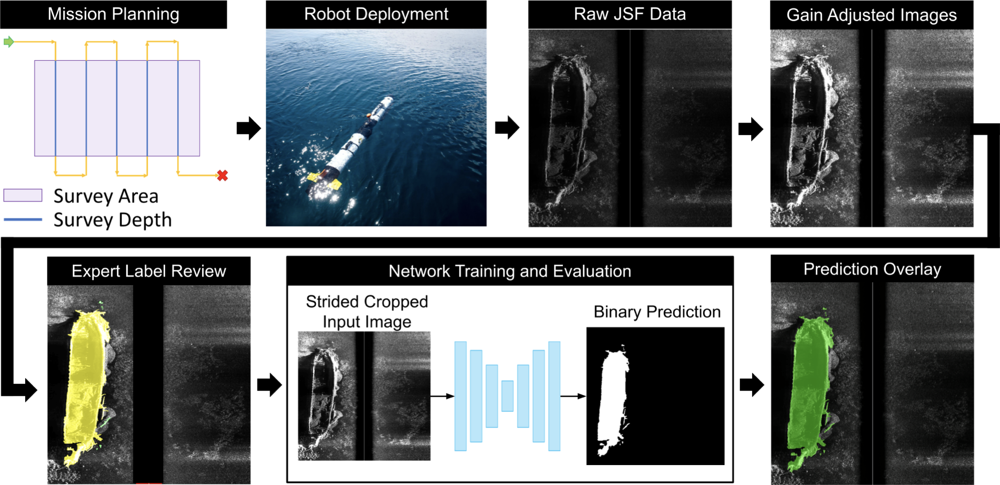

**Authors:** Advaith V. Sethuraman, Anja Sheppard, Onur Bagoren, Christopher Pinnow, Jamey Anderson, Timothy C. Havens, Katherine A. Skinner

**Venue:** International Journal of Robotics Research, 2024

We present a curated dataset of side scan sonar imagery of shipwrecks along with segmentation annotations, and benchmark a suite of machine learning methods. This work enables progress on a practically important but underexplored problem in marine robotics.

[Paper](https://journals.sagepub.com/doi/10.1177/02783649241266853) | [Project Page](https://umfieldrobotics.github.io/ai4shipwrecks/)

