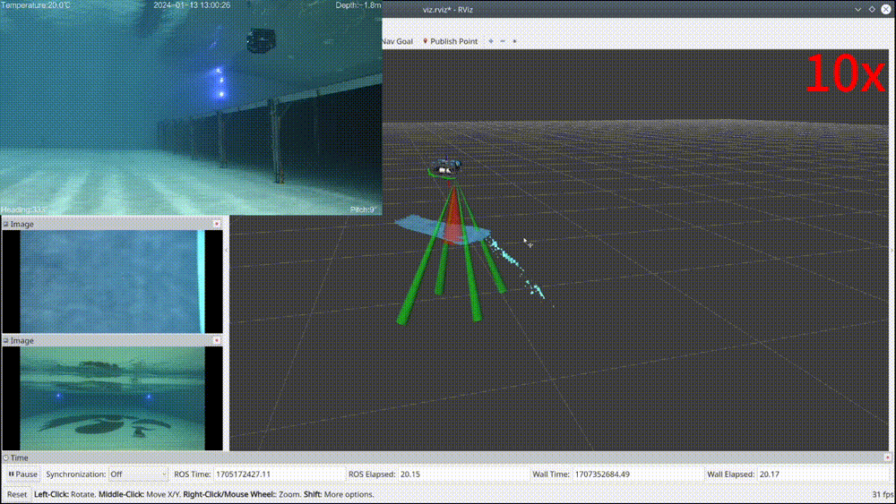

**Authors:** Jingyu Song\*, Onur Bagoren\*, Razan Adigani, Advaith V. Sethuraman, Katherine A. Skinner  
(\* equal contribution)

**Venue:** IROS 2024

Underwater mapping is hampered by poor visibility, lack of texture, and limited sensing modalities. TURTLMap combines stereo vision and other sensors on a low-cost UUV platform to achieve real-time dense mapping and localization in featureless underwater scenes.

[Paper (arXiv)](https://arxiv.org/pdf/2408.01569) | [Project Page](https://umfieldrobotics.github.io/TURTLMap/)

