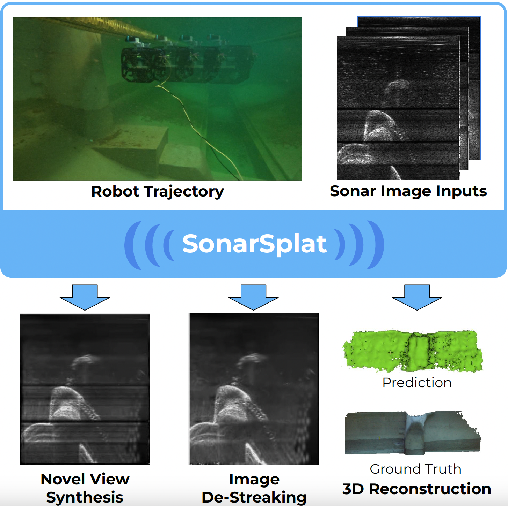

**Authors:** Advaith Sethuraman, Max Rucker, Onur Bagoren, Pou-Chun Kung, Nibarkavi N.B. Amutha, Katherine A. Skinner

**Venue:** IEEE Robotics and Automation Letters (RA-L), 2025

We extend 3D Gaussian Splatting to imaging sonar, a challenging modality with fundamentally different physics than cameras. SonarSplat enables novel-view synthesis of underwater sonar imagery, opening new avenues for underwater scene reconstruction and data augmentation.

[Paper (arXiv)](https://arxiv.org/abs/2504.00159)

