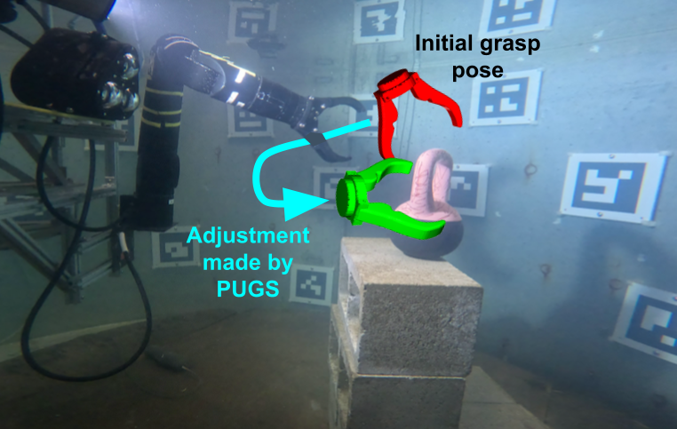

**Authors:** Onur Bagoren\*, Marc Micatka, Katherine A. Skinner, Aaron Marburg

**Venue:** ICRA 2025

Underwater grasping is challenging due to poor visibility, caustics, and turbidity. We introduce PUGS, which leverages perceptual uncertainty estimates to guide grasp selection, enabling more reliable manipulation in unstructured underwater environments.

[Paper (arXiv)](https://arxiv.org/abs/2502.09824) | [Project Page](https://onurbagoren.github.io/PUGS/)

