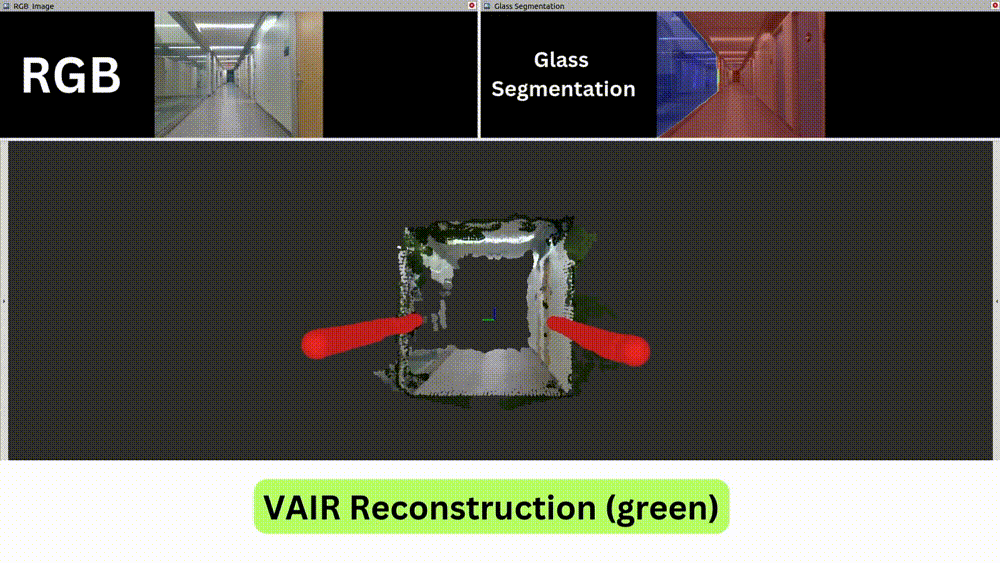

**Authors:** Advaith V. Sethuraman\*, Onur Bagoren\*, Harikrishnan Seetharaman, Dalton Richardson, Joseph Taylor, Katherine A. Skinner  
(\* equal contribution)

**Venue:** ICRA 2025

Transparent surfaces like glass present a fundamental challenge for purely visual reconstruction systems. VAIR couples low-cost acoustic sensing with visual measurements inside an implicit neural representation to achieve accurate geometry of transparent surfaces.

[Project Page](https://umfieldrobotics.github.io/VAIR_site/)

