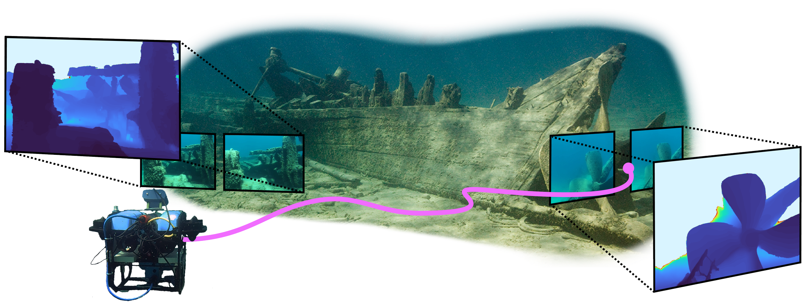

**Authors:** Onur Bagoren\*, Seth Isaacson\*, Sacchin Sundar, Yung-Ching Sun, Anja Sheppard, Haoyu Ma, Abrar Shariff, Ram Vasudevan, Katherine A. Skinner  
(\* equal contribution)

**Status:** In Submission

Stereo reconstruction underwater is challenging due to the domain gap between controlled laboratory conditions and real marine environments. SurfSLAM leverages simulation-to-real transfer to train robust underwater stereo models and integrates them into a real-time SLAM pipeline.

